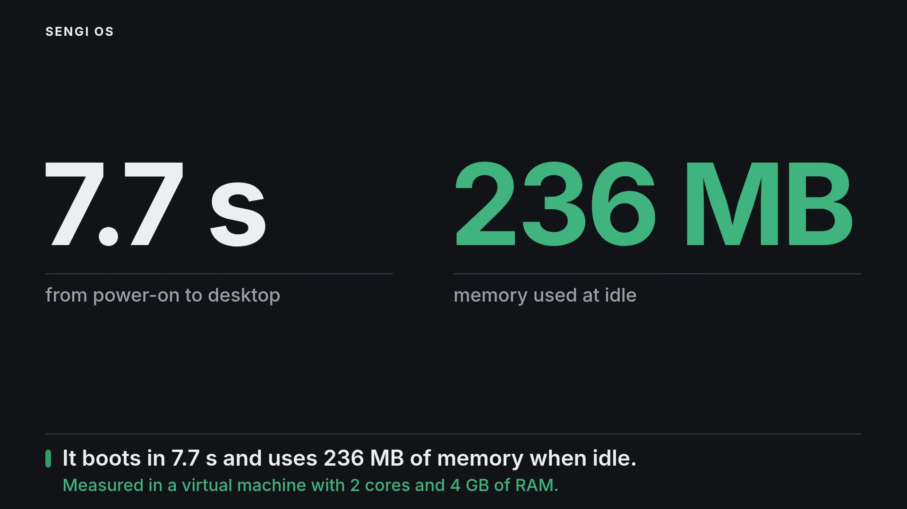
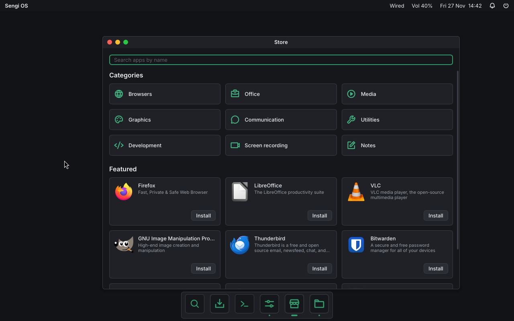
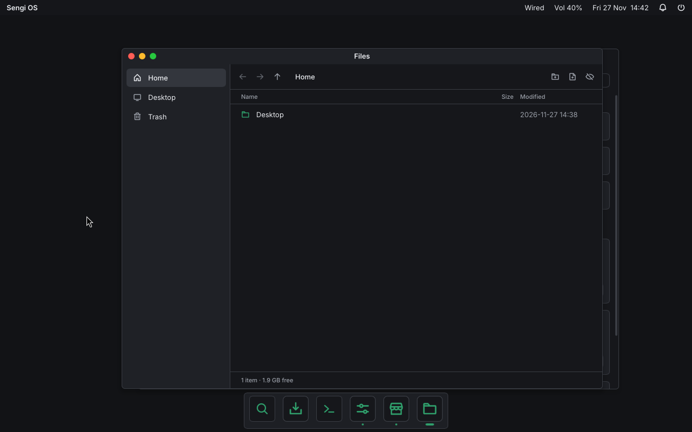

<p align="center">
  
</p>

<h1 align="center">Sengi OS</h1>

<p align="center">A fast, light desktop operating system built on Debian.</p>

<p align="center">
  <a href="https://github.com/itsallan/Sengi-Os/releases/latest"><b>Download 1.0.0</b></a> ·
  <a href="docs/media/sengi-os-1.0.mp4">Watch the video</a> ·
  <a href="docs/guide.md">Guide</a> ·
  <a href="CHANGELOG.md">Changelog</a>
</p>

<p align="center">
  <a href="docs/media/sengi-os-1.0.mp4">
    
  </a>
</p>

## Highlights

- **Fast and light.** Boots in 7.7 s and idles at 236 MB.¹ A release over
  10 s or 400 MB does not ship.
- **Its own desktop.** Compositor, shell and apps written in Rust and Slint.
- **Lean base.** Debian stable, systemd, Wayland and PipeWire. No Qt,
  Electron or GNOME desktop.
- **Ready to use.** Files, Store (Flathub), Settings, text editor, image
  viewer and installer.

<sub>¹ Live image in QEMU, 2 cores, 4 GB of RAM.</sub>

<p align="center">
  
  
</p>

## Install

Requires a 64-bit Intel or AMD computer with Secure Boot off, and a USB stick
of 2 GB or more.

```sh
sha256sum -c sengi-os-1.0.0-amd64.iso.sha256
```

Write the ISO to the stick (this erases it), boot from it, then open
**Install Sengi OS**. The live user and password are both `live`.

> [!WARNING]
> First release. Installing beside Windows, suspend and printing are not yet
> verified on real hardware. Back up your data first. See the
> [guide](docs/guide.md#installing).

## Build

Needs podman.

```sh
scripts/build-iso.sh                      # ISO in out/
scripts/boot-test.sh out/*.iso test-output
```

More in [development](docs/development.md) and the [roadmap](ROADMAP.md).

## Credits

Built entirely with [Claude](https://claude.com), mainly Claude Fable 5.2 and
Claude Sonnet 5.5.

## Licence

[GPL-3.0-or-later](LICENSE). Third-party work is listed in
[THIRD-PARTY-NOTICES.md](THIRD-PARTY-NOTICES.md).
